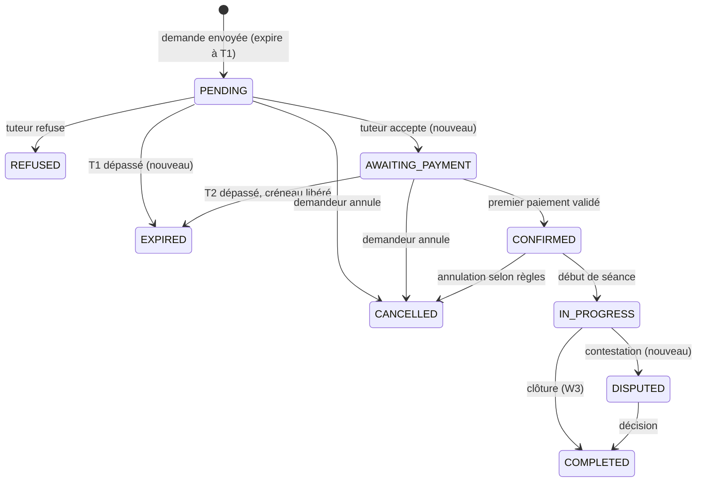
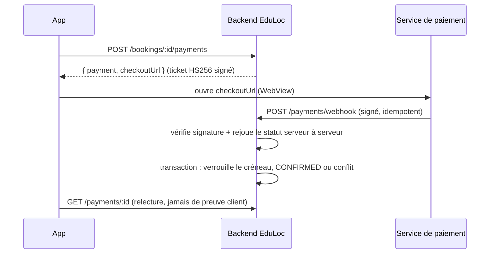
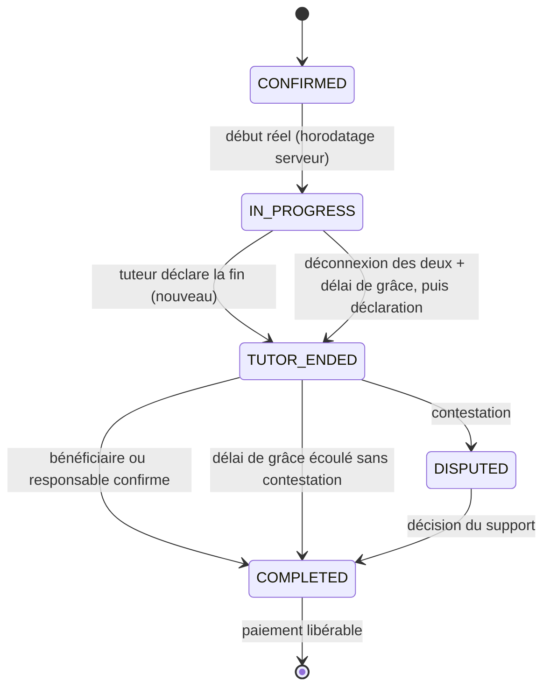

# Workflows EduLoc : explications et machines d'états

Chaque workflow indique : acteurs, états, transitions autorisées, invariants, événements émis. Les états réels déjà dans le schéma
(`BookingStatus` : PENDING, CONFIRMED, REFUSED, CANCELLED, IN_PROGRESS, COMPLETED) sont conservés ; les états ajoutés sont marqués **(nouveau)**.

## W1. Réservation (application et téléphone : même workflow)



Invariants :

- Accepter ne réserve pas : seul le **premier paiement validé** attribue le créneau (transaction + contrainte d'exclusion).
- `T1` (validité de la demande) est choisi par le demandeur parmi des durées proposées ; `T2` (délai de paiement) est un paramètre.
- Une demande expirée reste dans l'historique et peut être renvoyée avec des paramètres modifiés (nouvelle demande liée).
- Le prix est **figé** à la demande acceptée : modifier le tarif du tuteur ne touche pas les réservations existantes.

Événements : `booking.requested`, `booking.expired`, `booking.accepted`, `booking.confirmed`, `booking.cancelled`, `booking.refused`.

## W2. Paiement (coordonné avec la réservation, mais distinct)



Cas à traiter explicitement :

| Cas | Comportement attendu |
|---|---|
| Deux paiements presque simultanés | Un seul obtient le créneau ; l'autre passe en `CONFLICT` puis remboursement ou autre créneau (décision ouverte) |
| Webhook en double ou rejoué | Sans effet (idempotence par identifiant de paiement + `PaymentEvent`) |
| Webhook tardif après expiration | Paiement reçu sur réservation expirée : créneau repris si libre, sinon remboursement + tâche Odoo |
| Paiement échoué | Nouvelle tentative possible tant que `T2` court ; tâche d'assistance Odoo |
| Remboursement | Opération distincte, tracée, jamais déduite de l'UI |

## W3. Séance et clôture (double validation)



Règles :

- Chronomètre **serveur** ; événements de présence ; la déconnexion seule ne prouve pas la fin.
- Durées conservées : prévue, début réel, fin réelle, dépassement, motif, auteur de la clôture.
- Dépassement : aucun supplément sans règle tarifaire et consentement préalables.
- Bénéficiaire mineur : la confirmation revient au demandeur / responsable (décision ouverte).
- Désaccord : reversement bloqué, dossier Odoo, preuves conservées.

## W4. Finance : calcul et reversement

```
Prix client = tarif tuteur × durée + frais de déplacement + frais de service EduLoc (+ autres frais)
Taxes calculées à part (jamais mélangées au revenu EduLoc)
Net tuteur = revenu brut tuteur − prélèvement tuteur
Revenu net EduLoc = frais de service + commission − charges
```

Étapes : (1) paiement client capturé ; (2) séance COMPLETED ; (3) calcul et **figement** d'un `Settlement` (nouveau) ;
(4) reversement au tuteur, ligne séparée ; (5) écritures lisibles par Odoo. Chaque montant stocké en entier (plus petite unité) ou Decimal, jamais en flottant.

## W5. Réservation téléphonique (canal de vente)

```
Appel → Odoo : fiche du demandeur (sans compte) → conseiller cherche (API search) → consulte offres et créneaux (API)
→ appelle le tuteur si besoin → crée la demande via l'API EduLoc (rôle AGENT) → suit W1/W2 jusqu'à confirmation
```

- Le demandeur sans compte est un **contact invité** (nom, téléphone, éventuellement e-mail) rattaché au bénéficiaire.
- Le paiement se fait par lien de paiement envoyé (SMS/e-mail) : même service de paiement, mêmes webhooks.
- L'agent agit sous un rôle `AGENT` aux permissions limitées et auditées (qui a créé quoi pour qui).

## W6. Odoo : événements → activités

Backend → outbox → connecteur signé → Odoo. Idempotence par `event_id`. Les règles de relance sont configurables.

| Événement EduLoc | Activité Odoo |
|---|---|
| `booking.expired` | Tâche de relance |
| `booking.accepted` | Suivi client (rappel des modalités) |
| `payment.failed` | Tâche d'assistance |
| `payment.confirmed` | Note + préparation du suivi |
| `lesson.upcoming` | Rappel planifié |
| `session.completed` | Suivi qualité |
| `claim.created` | Dossier de traitement (état, responsable, priorité, historique) |
| `session.disputed` | Dossier prioritaire + blocage du reversement |

Sens inverse : Odoo n'écrit que par l'API EduLoc (création de réservation, enregistrement d'une décision de litige).

## W7. Validation d'un tuteur

`Inscription → dossier soumis → vérification Office → ACTIF / REFUSÉ / SUSPENDU`. Les offres et tarifs sont soumis à validation avant
publication ; une suspension masque le tuteur de la recherche et gère ses réservations à venir.
